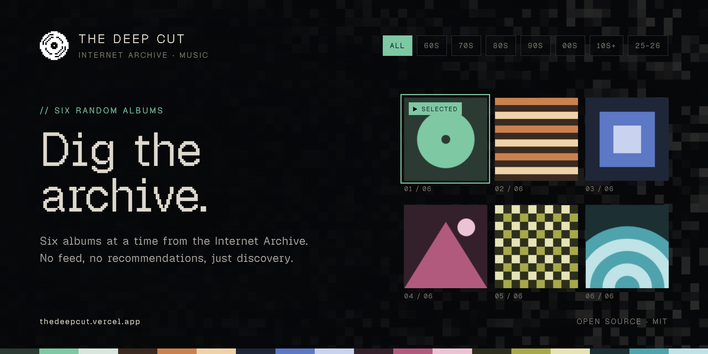

<p align="center"></p>

# The Deep Cut

**Six random albums from the Internet Archive. No feed, no recommendations, just discovery.**

Live at **https://thedeepcut.vercel.app** · Source: **https://github.com/mizerrrr/the-deep-cut**

The Internet Archive holds hundreds of thousands of freely licensed and historical music releases, most of them almost impossible to stumble upon. The Deep Cut picks six of them at random, each in a different style, and shows them as an editorial page: the cover, the tracklist and a player, with colors taken from each cover.

## What it does

- **Random picks.** Each search samples a different slice of the archive and shuffles it. Nothing is ranked by plays or by what you listened to before. The one exception is hip-hop mixtapes, which need at least 1,000 downloads to keep out anonymous DJ compilations.
- **Real albums only.** An item needs at least four distinct tracks (an MP3 and a FLAC of the same song count once), an original cover image and evidence of being a release. Podcasts, radio, sermons, lectures and audiobooks are dropped, and so are classical recordings.
- **AI filter.** Releases from 2025 on leave out albums that declare AI tools (Suno, Udio, Stable Audio and similar) in the title, description, tags or MP3 metadata, or whose cover keeps an image generator's default file name.
- **Era filters** from the 1960s to 2025–26.
- **A player that stays.** Playback, the tracklist, saved albums, liked tracks and listening history persist across navigation and reloads. All of it lives in the browser, with no account.
- **Installable** as a web app (PWA) with media controls.
- **Honest metadata.** Artist, year and region appear only when the archive record states them.

### Where the albums come from

Jamendo, Netlabels, the Free Music Archive, Unlocked Recordings, digitized LPs, open source releases, hip-hop mixtapes, and Brazilian, Latin American and Colombian *música campesina* collections, all through the Internet Archive's public Advanced Search and metadata APIs. The music belongs to its artists; every album links back to its archive.org page.

## Running it locally

Requires Node.js 18 or newer. There are no dependencies to install.

```sh
npm run dev
```

Then open http://127.0.0.1:4177. To use another port, copy `.env.example` to `.env` and set `PORT`.

The local server serves the page and the same two endpoints that run as Vercel Functions in production.

## How it is built

| File | What it does |
|---|---|
| `index.html` | The whole page: layout, styles, player and views, in one file |
| `albums.mjs` | Searches the archive, checks each item and builds the album list |
| `api/pool.mjs` | `/api/pool`: a ready-made set of six albums per era filter, cached at the CDN so a first visit doesn't wait on the search |
| `api/thumb.mjs` | `/api/thumb`: a same-origin copy of a cover thumbnail, so the page can read its colors |
| `server.mjs` | Local development server (`npm run dev`) |
| `assets/` | Logo, app icons and the Geist Pixel font |
| `sw.js`, `manifest.webmanifest` | Service worker and manifest for the installable app |

It is deployed on Vercel with no build step. Every push to `main` deploys to production; other branches get preview deployments. Visits are counted with Vercel Web Analytics, which sets no cookies.

## Credits

- Music and metadata: the [Internet Archive](https://archive.org) and the artists and labels who shared their work there.
- Font: Geist Pixel, under the SIL Open Font License (see `assets/fonts/OFL.txt`).

## License

The code is released under the [MIT License](LICENSE). The music is not part of this repository; each album keeps the license stated on its archive.org page.

This is a personal project. Issues and suggestions are welcome, but replies may be slow.

## Contact

Email: [ethedeepcut@gmail.com](mailto:ethedeepcut@gmail.com) · Instagram: [@ethedeepcut](https://www.instagram.com/ethedeepcut/)
